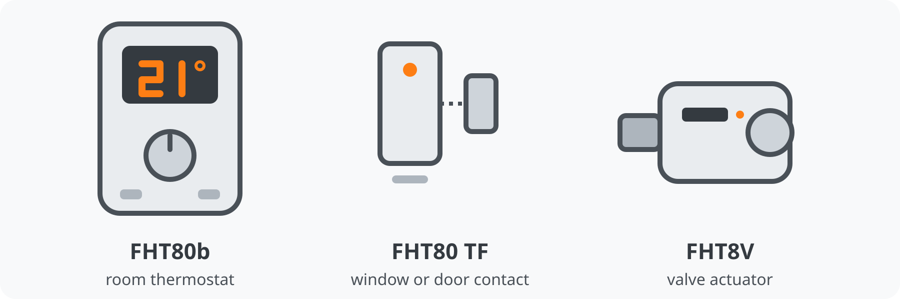

# culfw (CUL)

The culfw integration connects the ELV FHT80b room thermostats and FHT80 TF window contacts to Home Assistant. It talks to a [busware CUL868](https://www.busware.de/) stick that runs [culfw](http://culfw.de/) over a serial port, so no FHEM instance is needed. The thermostats and window contacts are made by [ELV](https://www.elv.com/).

The integration has no cloud part. It listens to the radio telegrams that the devices send on their own, and it sends commands to a thermostat through the stick, in the time slot in which the thermostat listens.

Use cases:

- Show the room temperature, the valve position, the battery state and the signal strength of every thermostat.
- Control a thermostat from Home Assistant: set the temperature and the mode, pick a preset, start a holiday, read and write the week program, and see it in a calendar.
- Switch off or lower the heating when a window is open, and get a message when a battery is low or a device has gone silent.
- Keep the clocks of the thermostats right: the integration sends the date and the time every night.
- Replace FHEM as the central of the FHT system. The thermostats stay registered when you use the same central code.

The integration is under development. It was tested against a simulator of the stick and a recording of the radio traffic of a real FHEM installation. It also ran on a real busware CUL868 in a house with five known FHT80b thermostats and eight FHT80 TF contacts. The first tests on the real stick were on 2026-10-18 and 2026-10-19, where it read and wrote values, the week program, holidays and presets. [Known limitations](#known-limitations) lists what is not verified yet.

The integration is licensed under the Apache License 2.0, the license of Home Assistant itself. This repository is private, and the integration is not part of HACS. See [Installation](#installation).

## The radio system behind it

FHT is part of the 868 MHz radio system that ELV sold together with the FS20 switches and the HMS sensors. In that system a central controls the devices: the FHZ 1000 PC and the FHZ 2000 were such centrals. Conrad Electronic sold the same devices under its own name. Each FHT80b is registered with one central, and it only talks to that central (see the special function `CEnt` in the manual of the thermostat).

The busware CUL868 takes the role of the central. It is a USB stick with a CC1101 radio chip and an ATmega32U4 microcontroller that runs the open source firmware culfw. busware describes the firmware as a decoder for the 868 MHz traffic of FS20, FHT, EM, KS and HMS devices, and FHEM has used the same stick for the same job for years. This integration speaks the culfw commands to the stick directly and does not need FHEM.

ELV, Conrad, eQ-3 and busware are not affiliated with this project. Their names only say which devices the integration works with.

Sources: [ELV FHT 80B data sheet](https://media.elv.com/file/62489_fht_80b.pdf), [ELV article on the FHZ 1000](https://media.elv.com/file/2003_01_13_fhz1000.pdf), [Conrad manual of the FHT 80B set](https://asset.conrad.com/media10/add/160267/c1/-/de/000646463ML02/manual-646463-fht-80btf-wireless-thermostat-saving-set.pdf), [busware CUL-V1](https://busware.de/products/cul-v1/) and [busware CUL](https://busware.de/products/cul/).

## Why this exists and who it is for

The system is old. It has probably few active users today, but the devices have kept running reliably in the installation of the author for many years. There is no reason to throw working devices away and buy new ones, and this integration is meant to keep them in use: reusing the hardware that already exists is better for the environment than replacing it, and it keeps the heating of the house under local control.

So far the integration covers only the devices that the author owns: five FHT80b room thermostats, eight FHT80 TF window contacts and one busware CUL868. The author has no other devices. If you have other ELV devices of this radio system, for example other thermostat or contact variants, adding them is probably not a lot of work. Open an issue in the repository and describe the device, and a recording of its radio telegrams helps. The author can test only what is at home.

## Supported devices



The drawings are original and only show what to look for: the thermostat with its display and wheel, the contact with its magnet, and the valve actuator on the radiator. The FHT8V valve actuators are controlled by their FHT80b and are not addressed directly (see [Unsupported devices](#unsupported-devices)).

- ELV FHT80b room thermostat (called FHT80b here), with its valve, its temperature sensor and its week program.
- ELV FHT80 TF window contact (called FHT80 TF here). A contact has a window sensor and a battery state, and a thermostat that is paired with it lowers the temperature by itself when the window opens.
- busware CUL868 with culfw 1.66, attached to the host of Home Assistant. USB discovery recognizes it by its USB IDs (`03EB:204B`), the manufacturer `busware` and the product name `CUL868`.

One CUL is supported per Home Assistant.

## Unsupported devices

- Other radio devices that the stick hears, such as FS20, HMS or HomeMatic devices, are ignored. Only FHT80b and FHT80 TF telegrams are decoded.
- ELV FHT 8v radio valves (the direct mode of culfw) are not supported. The integration never sends to the code range in which culfw drives such valves itself.
- A CUL for 433 MHz (CUL433) and other culfw sticks are not tested, and USB discovery does not offer them. The FHT protocol runs on 868 MHz.
- A virtual FHT80 TF (the emulation of a window contact by the CUL), tamper or sabotage messages of the FHT80 TF, the configuration of the radio chip of the CUL, and the other report modes of culfw are not supported either.

## Prerequisites

1. A CUL868 with culfw 1.66, plugged into the host of Home Assistant. If Home Assistant runs in a virtual machine, pass the stick through to it by vendor and product ID (`03eb:204b`), not by USB port, so that the stick finds its way back after it re-enumerates.
2. No other program may hold the serial port. Stop FHEM, or remove its CUL definition, before you set up the integration.
3. The central code of the CUL. The CUL is the central of your FHT system, and the thermostats register with it. FHEM calls this code FHTID, and this documentation also calls it the house code. If FHEM was your central, use the code that FHEM wrote to the stick, and the thermostats keep working. For a new setup you can choose any code. The setup form suggests the code that the stick stores, and a different code is written to the stick after you confirm it, which clears its FHT buffers. The central code is not the security code (`CodE`) of a thermostat, see [Central code and security code](#central-code-and-security-code).
4. The user that runs Home Assistant has to be allowed to open the serial port (on Linux, usually the group `dialout`).

## Installation

The integration is not in the default catalog of HACS yet. Until it is, add it as a custom repository: in HACS open the menu, choose **Custom repositories**, enter `https://github.com/SpawnY0815/ha-culfw` with the type **Integration**, then install **culfw (CUL)** and restart Home Assistant.

To install it by hand, copy the folder `custom_components/culfw` of the [release](https://github.com/SpawnY0815/ha-culfw/releases) you want to the `custom_components` folder of your Home Assistant configuration and restart Home Assistant.

Home Assistant 2026.10.0 or newer is required. Read [CHANGELOG.md](CHANGELOG.md) before an update: it lists what changed and what needs your action.

## Configuration

The setup takes five steps. [Screens of the setup](docs/screens.md) shows every screen of the setup, the reconfiguration and the options, built from the texts and fields of the code.

1. Add the integration under **Settings** > **Devices & services** > **Add integration** > **culfw (CUL)**. If the stick is plugged in, Home Assistant also offers it as a discovered device (USB discovery), and you only confirm it. Otherwise select the serial port by hand. The setup reads the CUL before it asks for the central code. It changes nothing on the stick while it reads.
2. Enter the central code as two numbers. The form suggests the code that the stick stores and shows it with its hexadecimal form. If you enter another code, a confirmation shows the old and the new code, in both forms, and asks before it writes the new one to the stick. A new central code means that you release every FHT80b for registration at the thermostat, see below.
3. Listen for the devices. A device announces itself only when it sends, so choose **Listen for devices** and wait about 5 minutes while a progress page lists the thermostats and window contacts that the CUL hears, with their signal strength. Thermostats send about every 2 minutes, window contacts when they change and otherwise about every 4 minutes, so the 5 minutes cover a quiet contact; opening or closing it makes it appear sooner. A thermostat with empty batteries, or one whose `CEnt` does not show `On` (see below), sends nothing and does not appear. Choose **Skip and set up without devices** when the batteries are not in yet: nothing is lost, because the integration adds new devices automatically (see **Add new devices automatically** in the options) or lists them as candidates. The page closes by itself, and closing it earlier cancels the setup.
4. Read the summary of the devices that were heard and answer two questions. For each window contact the form has a list, **Window** or **Door**, because a contact cannot tell what it watches. And **Read week programs automatically** (on by default) decides whether the integration reads the week program of every thermostat on its own. A thermostat answers only in its time slots, so the first two days arrive after about 11 minutes and all seven after about 35 minutes. The integration reads one thermostat at a time in the background, so four thermostats take about 2.5 hours. The answers become the options of the entry and stay changeable.
5. Name the devices. After the entry is created, Home Assistant shows a dialog to name the new devices and assign them to areas. It lists only the devices that exist at that moment, which is usually the CUL alone, because a thermostat or contact becomes a device when the integration hears its next telegram. A device that appears later gets its name and area from its device page under **Settings** > **Devices & services** > **culfw (CUL)** > **Devices**.

Open the options later to adjust what the integration cannot know: ignore the devices of a neighbor, change what a window contact watches, say which thermostat each contact belongs to (see [Window contacts and thermostats](#window-contacts-and-thermostats)), and change whether the week programs are read. See [Configuration options](#configuration-options).

Fields of the setup:

- **Serial port**: The port of the CUL. A path such as `/dev/ttyACM0` is stored as the stable path under `/dev/serial/by-id/` when the host has one, because the number of such a port changes when the host enumerates its USB devices in another order. A port that is a URL (`socket://`, `rfc2217://` or `esphome://`) stays as it is.
- **Central code, first number** and **Central code, second number**: The central code of the CUL as two whole numbers from 1 to 99, because the CUL cannot use a part of 0. Home Assistant config flows cannot place two fields side by side, so the form shows two boxes below each other. The integration converts the numbers to the hexadecimal code that the CUL stores, for example 16 and 52 to `1034`, so you never have to convert anything. The form suggests the code that the CUL stores, and its description shows that code in both forms. A different code is written to the CUL after you confirm it with **Overwrite**, which clears the FHT buffers of the CUL. FHT80b thermostats that are registered with the old code no longer accept commands until you release them for registration.
- **Window or door per contact**: One list for each window contact that was heard while the setup listened, labeled with the address of the contact, for example **FHT80 TF 783646**. The default is window.
- **Read week programs automatically**: The same option as in the options, on by default. See [Configuration options](#configuration-options).

The listening opens the CUL with the central code that it holds and writes nothing to it, so a new central code is written when the entry is set up, after the summary. The CUL belongs to the setup while it listens, so the entry is created afterwards, when the port is free again.

Select **Reconfigure** in the menu of the integration to change the serial port or the central code later (**Settings** > **Devices & services** > **culfw (CUL)** > the three dots of the entry > **Reconfigure**). Home Assistant reloads the integration afterwards. When the stick shows up under a new device path, for example after you plugged it into another USB port, USB discovery updates the stored port and reloads the integration.

### Central code and security code

Two codes matter in an FHT system, and they are easy to mix up.

- The **central code** belongs to the CUL, the central of the system. FHEM calls it `FHTID` of the CUL. It is two numbers from 1 to 99, stored as four hexadecimal digits (`016 052` is `1034`). You set it in the setup of the integration, and the integration shows it in the setup form, in the attributes `house_code_display` and `house_code` of the thermostats and the CUL, and as the serial number of the CUL device. The thermostat does not show it.
- The **security code** (`CodE`) belongs to each thermostat. FHEM uses it in `define <name> FHT 3F48`. The display shows it as `Code 1` and `Code 2`, two numbers from 0 to 99 with three digits each (`063 072` is `3F48`). You set it on the thermostat. The integration shows it in the name of the device (**FHT80b 063 072**) and in the attribute `display_code`.

The thermostats register with the central, and the CUL addresses a thermostat by its security code. A thermostat works with one central only, the one it is registered with (chapter 3.9.9 of the manual of the FHT80b). To see or change the registration, use the special function `CEnt` of the thermostat:

- Hold **PROG** until `Sond` shows, select `CEnt` with the wheel and press **PROG**. The display shows the state: `On` means the thermostat is registered with a central, `Off` means no radio communication, and `nA` means it is released for registration.
- To register the thermostat with a central that has another code than before, which is the case in a new setup, choose `nA` with the wheel and confirm with **PROG**. The thermostat shows `On` once it is registered.
- Thermostats that FHEM registered keep working when you enter the same central code in the setup.

To read the security code of a thermostat, hold **PROG** until `Sond` shows, choose `CodE` with the wheel and confirm with **PROG**. The display shows `Code 1` with three digits, for example `063`. Confirm with **PROG** again and it shows `Code 2`, for example `072`. Do not change it for this integration. A new security code has to be transmitted to the valve actuators again (chapter 3.9.4 of the manual).

## Configuration options

Select **Configure** in the menu of the integration. Saving changed options reloads the integration once. [Screens of the setup](docs/screens.md) shows all three pages of the options.

- **FHT80b silent after**: Hours without any telegram after which an FHT80b counts as gone. Its values become unavailable and a repair issue is raised. The default is 2 hours.
- **FHT80 TF silent after**: The same for the window contacts. The default is 4 hours.
- **Add new devices automatically**: On by default. The integration adds every FHT device that the CUL hears for the first time. Turn it off when devices of a neighbor are in range. New devices then wait as candidates, up to 20 (a new one pushes out the one that was heard longest ago), and the form offers them under **Add new devices** and **Ignore new devices**, labeled with their signal strength. The choice takes effect when you save, and a candidate that you add has no values until it sends its next telegram.
- **Ignored devices**: Devices whose telegrams are dropped. Selecting a device removes it with its entities, for example for the thermostat of a neighbor. The default is none.
- **Read week programs automatically**: On by default. The integration reads the week program of each thermostat on its own once after its first contact (as soon as its settings are known), again after the CUL was reset, and then every 24 hours counted from the last complete read, so that the schedule calendar shows what the thermostat holds, also after you changed it at the thermostat. A thermostat answers only in its time slots, so the 28 switch times of a week take about 35 minutes (the first two days arrive after about 11 minutes), and the integration reads one thermostat at a time, so four thermostats take about 2.5 hours. It runs in the background. It never asks a thermostat that is not confirmed, one that did not echo the last messages, or one that has a command of yours waiting, and it keeps off the radio for the first minutes after a connect. Turn it off to read a week program only with the **Refresh schedule** button.
- **Add the week program card automatically**: On by default. The integration adds its dashboard card to the resources of your dashboards, so that the card appears in the list of cards (see [Week program card](#week-program-card) for the name to search for and where the resource is). Turn it off to add the file yourself. Turning it off does not remove a resource that is there already.
- **Window or door per contact**: The setup asks for it after listening. When the integration has window contacts, or you add one here, **Next** leads to a second page with one list per contact. A contact cannot tell whether it sits at a window or at a door, so you choose **Window** or **Door** for each one. The default is window. The lists are labeled with the contact address and, if you renamed the device, its name. The choice sets the device class of the open state of the contact, so a door shows as a door and the entity is named **Door**. The change takes effect when you save, through the reload of the integration, and the entity, its ID and its history stay. Home Assistant derives an entity ID from the name when it creates the entity, so a contact that is a door from the start gets an ID that ends in `_door`, while a contact that you change from window to door later keeps the ID that ends in `_window`. A contact that you add from the candidates is asked for on this page as well, so it starts with the right class. If you changed the device class of that entity in its settings, your setting wins over the choice here.
- **Window contacts of each thermostat**: A third page, which follows the choice of window or door when the integration has a thermostat. It has one list for each window contact, labeled like the lists of the second page, with the thermostats of the house and **Not assigned**, which is the default. A thermostat that the radio traffic points to is the default of its contact and is labeled **suggested** with its confidence in words (low, medium or high), and nothing is applied until you save. Choosing **Not assigned** turns a suggestion down for good. The choice only fills the attributes `thermostat` of the contact and `window_contacts` of the thermostat, and it changes nothing on the thermostat. See [Window contacts and thermostats](#window-contacts-and-thermostats).
- **Recovery**: A collapsed section with two last resorts of the watchdog, both off by default: **Allow rebooting the CUL** and **Allow resetting the USB link**. Both make the stick leave the USB bus for a moment, so turn them on only when the stick is passed through to Home Assistant by vendor and product ID and has a link under `/dev/serial/by-id/`. Leave them off when the stick is bound to a fixed port such as `/dev/ttyACM0`. The USB reset also needs the serial port of the integration to be that link: the integration logs a warning and does not reset the USB link when the port is anything else.

## Supported functionality

A thermostat is named after its security code (`CodE`), which its display shows as `Code 1` and `Code 2`, written with three digits each and a space between them, for example **FHT80b 063 072**. The same name is used in the device list, in the options, in repair issues, in the logbook and in the log of Home Assistant, so you can find the thermostat by the numbers that you read on its display. A window contact has no display and shows no address anywhere, so it keeps its six-digit hexadecimal address, for example **FHT80 TF 783646**. To tell the contacts apart, open one window and see which contact reports it, then rename the device. A name that you choose is kept. Behind the names the devices keep the hexadecimal codes as their identifiers, so a name never changes the unique IDs. New thermostats get entity IDs such as `climate.fht80b_063_072`, and entities that already exist keep the IDs they have.

Every FHT device has the entities below. Entities that are marked as disabled by default are in the entity list of the device, and you enable them there. The values of a thermostat are unavailable while it is silent for longer than its threshold or while the CUL has been away for 15 minutes.

### Climate

- **Thermostat**
  - Description: Controls an FHT80b. It shows the measured temperature, the setpoint, the HVAC mode (auto, heat or off), the preset and whether the valve is open. It takes the standard Home Assistant actions, see [Controlling a thermostat](#controlling-a-thermostat). The attribute `preset_end_time` tells when a holiday or party ends, `valve_switch` is `on` or `off` while the thermostat holds the valve open or closed, and `pending` is true while a requested value waits for the thermostat. The entity carries many more attributes, see [Entity attributes](#entity-attributes).
  - Available for: FHT80b
  - Remarks: It takes the name of its device. A requested value is shown as pending until the thermostat echoes it.

### Calendar

- **Heating program**
  - Description: The heating phases of the week program as a calendar. Each phase repeats every week and is named **Comfort** with the day temperature of the thermostat, for example **Comfort 21 °C**, or only **Comfort** while the day temperature is unknown. The state is on during a phase and off otherwise, and the calendar shows the current phase, or the next one. The attribute `known_days` lists the weekdays that the thermostat has reported.
  - Available for: FHT80b
  - Remarks: Read-only. The times are the clock of the thermostat, which is the time of Home Assistant. A phase that ends at 24:00 ends at the next midnight. See [Week program](#week-program).

### Sensors

- **Temperature**
  - Description: The measured room temperature.
  - Available for: FHT80b
  - Remarks: None.
- **Valve**
  - Description: The position of the valve in percent.
  - Available for: FHT80b
  - Remarks: None.
- **Actuator state**
  - Description: What the valve actuator does, for example regulating, synchronizing or lime protection.
  - Available for: FHT80b
  - Remarks: Disabled by default. Diagnostic entity.
- **Holiday ends**
  - Description: The time at which a running holiday or party ends.
  - Available for: FHT80b
  - Remarks: Disabled by default. Diagnostic entity. The climate entity shows the same time.
- **Signal strength**
  - Description: The signal strength of the last telegram.
  - Available for: FHT80b, FHT80 TF
  - Remarks: Disabled by default. Diagnostic entity.
- **Last seen**
  - Description: The time of the last telegram.
  - Available for: FHT80b, FHT80 TF
  - Remarks: Disabled by default. Diagnostic entity. It stays available while the device is silent.
- **Time acknowledged**
  - Description: The time at which the thermostat last confirmed the date and time that the integration sent.
  - Available for: FHT80b
  - Remarks: Diagnostic entity. It stays available while the device is silent.
- **Week program status**
  - Description: How much of the week program the thermostat reported, and whether a write is on its way: unknown (no day), partial (some days), complete (all seven days) or writing (a day waits for its turn or for the echo of the thermostat).
  - Available for: FHT80b
  - Remarks: Diagnostic entity. The attributes `known_days` and `week_program_read_at` tell which days the thermostat reported and when the last complete read ended. It is unavailable while the thermostat is silent.
- **FHT buffer free**
  - Description: The free bytes in the FHT send buffer of the CUL. It holds 174 bytes when empty.
  - Available for: CUL
  - Remarks: Diagnostic entity. Polled every 5 minutes.
- **Duty cycle credit**
  - Description: The radio budget that is left of the 1 percent duty cycle, in seconds.
  - Available for: CUL
  - Remarks: Diagnostic entity. Polled every 5 minutes.
- **Uptime**
  - Description: The time at which the CUL last started.
  - Available for: CUL
  - Remarks: Diagnostic entity. Polled every 5 minutes.
- **Buffer overflows**
  - Description: How often the CUL reported a full FHT buffer since the integration started.
  - Available for: CUL
  - Remarks: Diagnostic entity.
- **Duty cycle overflows**
  - Description: How often the CUL reported that the duty cycle budget was used up since the integration started.
  - Available for: CUL
  - Remarks: Disabled by default. Diagnostic entity.

### Binary sensors

- **Window**
  - Description: On while a window is open. For a window contact, it is the state of the contact. For a thermostat, it is on while any contact that is paired with the thermostat is open.
  - Available for: FHT80b, FHT80 TF
  - Remarks: A silent window contact is unavailable, so the entity never claims that a window is closed from old data. A window contact can watch a door instead (see the options), and the entity is then named **Door** and has the device class door. Its unique ID and the model of the device, FHT80 TF, stay.
- **Low temperature alarm**
  - Description: On while the thermostat reports its low temperature alarm.
  - Available for: FHT80b
  - Remarks: None.
- **Window sensor fault**
  - Description: On while the thermostat reports a fault of its window sensor.
  - Available for: FHT80b
  - Remarks: Diagnostic entity.
- **Battery**
  - Description: On while the device reports a weak battery.
  - Available for: FHT80b, FHT80 TF
  - Remarks: Diagnostic entity.
- **Connectivity**
  - Description: On while the device is heard (for a device) or while the serial port of the CUL is open and initialized (for the CUL).
  - Available for: CUL, FHT80b, FHT80 TF
  - Remarks: Diagnostic entity. It stays available while the device is silent, because off is the alarm.

### Numbers

The numbers set values that the thermostat keeps. They are unknown until the thermostat has reported its settings, which the integration asks for automatically. A value between two steps rounds half up, so 20.25 becomes 20.5. A value that you set is shown as pending until the thermostat echoes it. If the thermostat echoes another value, for example after you turned its dial, the entity shows the value of the thermostat.

- **Day temperature**
  - Description: The temperature the week program holds inside its periods, from 5.5 to 30.5 °C in steps of 0.5. It is also the comfort preset.
  - Available for: FHT80b
  - Remarks: Configuration entity.
- **Night temperature**
  - Description: The temperature outside the periods, from 5.5 to 30.5 °C in steps of 0.5. It is also the eco preset.
  - Available for: FHT80b
  - Remarks: Configuration entity.
- **Window open temperature**
  - Description: The temperature the thermostat holds while its window sensor reports an open window, from 5.5 to 30.5 °C in steps of 0.5.
  - Available for: FHT80b
  - Remarks: Configuration entity.
- **Low temperature alarm offset**
  - Description: How far below the setpoint the room may get before the thermostat raises its low temperature alarm, from 1 to 5 °C in steps of 1.
  - Available for: FHT80b
  - Remarks: Disabled by default. Configuration entity.

### Buttons

A button fails with a message when the thermostat was not heard in the last 15 minutes, because it would never collect the request.

- **Sync time**
  - Description: Sends the date and the time to every thermostat that was heard in the last 15 minutes. The integration does this by itself every night at 04:05.
  - Available for: CUL
  - Remarks: Configuration entity. The press succeeds when the time was queued. It goes out when the radio budget of the CUL allows, which can take a few minutes (see [Known limitations](#known-limitations)). It fails with a message when no thermostat is known yet, and when none of them takes the time. It is unavailable while the CUL is not connected.
- **Refresh settings**
  - Description: Asks the thermostat for its mode, its setpoint, its day, night and window open temperature, its low temperature alarm offset and its warnings. The thermostat answers in its next time slots, within a few minutes.
  - Available for: FHT80b
  - Remarks: Configuration entity. The integration asks for these by itself when it needs them, so use the button after you changed something at the thermostat itself.
- **Refresh schedule**
  - Description: Asks the thermostat for its week program, 28 telegrams that keep the radio of the thermostat busy for minutes.
  - Available for: FHT80b
  - Remarks: Disabled by default. Configuration entity. The integration reads the week program by itself as well, unless you turn that off in the options, so use the button when you want the program now, for example after you changed it at the thermostat.

### Entity attributes

The thermostat, the window contact and the CUL carry everything the integration knows about the device as state attributes, so a template or an automation can read it. The names are English and written in snake case. They are not translated, because a name is a key. A value that the device has not reported yet is `none`. Apart from `pending`, `pending_since` and `valve_switch`, the attributes show what the device reported, never a value that still waits for its echo. The history skips them, except for the ones that explain a state, which are marked below. Skipping hides the values from the stored attributes only. The thermostat reports about every 2 minutes, and `last_seen` and `rssi_dbm` change with each telegram, so Home Assistant still writes a state change for the thermostat each time. The history shows the same state again, and the logbook and automations that trigger on any change of the climate entity see it. Use the sensors for the last seen time and the signal strength, or trigger on a state or on one attribute, to avoid that.

The thermostat (the climate entity) has the attributes:

- `display_code`: The code of the thermostat as its display shows it, for example `063 072`. It is `none` for a code that no display can show.
- `device_code`: The same code as four hexadecimal digits, for example `3F48`. The radio and the unique IDs use this form.
- `house_code_display` and `house_code`: The central code of the CUL that the thermostat takes commands from, as two numbers (`016 052`) and as four hexadecimal digits (`1034`). The thermostat does not show this code. See [Central code and security code](#central-code-and-security-code).
- `last_seen`: The time of the last telegram.
- `rssi_dbm`: The signal strength of the last telegram.
- `valve_position`: The position of the valve in percent.
- `measured_temperature`: The measured room temperature.
- `desired_temperature`: The setpoint that the thermostat holds. It is 5.5 and 30.5 for the valve switches, which the target temperature of the entity hides.
- `mode`: The mode as the thermostat reports it, one of `auto`, `manual`, `holiday` and `holiday_short`. The history keeps it.
- `day_temperature`, `night_temperature`, `windowopen_temperature` and `lowtemp_offset`: The settings of the thermostat.
- `battery_low`, `low_temperature_alarm`, `window_open` and `window_sensor_fault`: The four warnings of the thermostat.
- `window_contacts`: The addresses of the window contacts that you assigned to the thermostat in the options, for example `['783646']`. It is empty until you assign one. A contact that is only suggested is not in the list.
- `settings_read_at`, `week_program_read_at`, `mode_read_at` and `time_acknowledged_at`: When the settings were last read, when the last complete read of the week program ended (28 different switch times in one read), when the mode was last read and when the thermostat last confirmed the time.
- `holiday_end`: When a holiday or party ends. The attribute `preset_end_time` holds the same time, and the history keeps that one.
- `confirmed` and `echoed_at`: Whether the thermostat is known to take commands of this CUL, and the time of its last echo. Nothing is sent to it automatically before that.
- `pending` and `pending_since`: Whether a requested value waits for the thermostat, and since when. A day of the week program that you wrote counts as well.
- `valve_switch`: `on` or `off` while the thermostat holds the valve open or closed. The history keeps it.

The open state of a window contact has the attributes `address` (the six hexadecimal digits that are the only code of a contact), `last_seen`, `rssi_dbm`, `battery_low`, `contact_type` (`window` or `door`, as chosen in the options), `thermostat` (the code of the thermostat that the contact belongs to, as its display shows it, for example `093 016`) and `thermostat_source` (`manual` when you chose the thermostat, `suggested` when only the radio traffic points to it). Both are `none` for a contact without a thermostat. `thermostat_confidence` (`low`, `medium` or `high`) and `thermostat_events` (the number of changes of the contact that the suggested thermostat answered) say why a thermostat is suggested, and are `none` unless `thermostat_source` is `suggested`; see [Window contacts and thermostats](#window-contacts-and-thermostats).

The connectivity sensor of the CUL has the attributes `firmware` (the version of culfw), `house_code_display` and `house_code`.

The device registry has the same information. The serial number of a thermostat is its display code, the serial number of the CUL is its central code in the display form, and the serial number of a contact is its address. The model ID is `fht80b` or `fht80tf`, and the hexadecimal code is a connection of the device (type `fht_device_code`, or `fht_house_code` for the CUL), which `device_attr(device_id, 'connections')` reads in a template. The firmware of the CUL is the software version of its device. The diagnostics download uses the same attribute names under `attributes` and hides the house code and the host of a port that is a URL.

### Window contacts and thermostats

How it is. A window contact (FHT80 TF) is paired with a thermostat, not with Home Assistant. The thermostat stores up to four contacts in its slots 1 to 4 (the special function `FEn`, chapter 3.9.10 of the manual of the FHT80b) and lowers its setpoint to the window open temperature while one of them is open. A contact may be paired with more than one thermostat, and each of them then reacts. The contact sends its state on the radio, so the CUL hears it as well, but its telegrams do not say which thermostat it is paired with. Home Assistant shows contacts and thermostats as devices of their own, both behind the CUL. The integration does not make a contact a device behind a thermostat (`via_device`), because a contact is no part of the thermostat.

Why the thermostat does not tell. The display of the thermostat shows only the state of each slot, never the code of the contact in it, and the thermostat sends no list of its contacts on the radio. So nothing can read the pairing from the thermostat, and nothing on the radio names it. The integration can only watch who reacts.

What the state Window of the thermostat means. The binary sensor **Window** of a thermostat and its attribute `window_open` are on while at least one of its contacts is open. The thermostat reports this flag in its warnings, some seconds to a few minutes after the contact sent its telegram (8 to 226 seconds in the recording of the house). It does not say which contact opened, and it stays on until the last open contact is closed. A thermostat whose contact slots are empty never turns it on.

How the integration recognizes the pairing. A thermostat that has the contact answers a change of its state with a telegram that is not on its regular schedule, usually the desired temperature, and sometimes the warnings. A thermostat that is not paired with the contact does not. How fast the answer comes differs: in the live test of the owner a thermostat answered an opening within about a second and a closing after 43 seconds, and in the recording of two days in the house the thermostat of one pair answered after 0 to 225 seconds, with a median of about 50 seconds and only 2 of 12 answers within 3 seconds. When exactly one contact changed and exactly one thermostat answered within 3 seconds, that is the strong sign for the pair. The window flag of the thermostat within 5 minutes after the contact changed is a weaker one. A thermostat that could have heard the change and stayed silent while another one answered counts against its pair, a little. Changes that two contacts could have caused count for nobody. An answer within 3 seconds while another contact changed earlier and nobody answered that one counts only as the weaker sign, because it may be the late answer to the earlier contact. In the recording of the house, one pair was answered 12 times in 12 and three times within 10 seconds, and no other pair ever was. The measurements are in [the protocol notes](docs/protocol.md#which-contact-belongs-to-which-thermostat).

Suggestions. Opening and closing a window once is enough to get a suggestion if the thermostat answers quickly. Otherwise it takes three changes of the window flag. The contact then shows the thermostat in `thermostat` with `thermostat_source: suggested`, and the log says so once. Two attributes tell you why: `thermostat_confidence` is `low`, `medium` or `high` from the votes, and `thermostat_events` is the number of changes of the contact that the thermostat answered and that no other contact could have caused. One clean answer gives `low`. A second sign makes it `medium`, and two quick answers make it `high`. Another thermostat that gets votes as well lowers the confidence by one level. A thermostat that answers late, as the one of the house recording usually did after 11 seconds to 4 minutes, or only by its window flag, needs three changes of that flag for a suggestion, which is about two rounds of opening and closing. In the recording of two days in the house, one of eight contacts could be assigned this way: five of the eight never changed their state, and two changed twice each while the flag of the thermostat of another contact was already up, so they got no vote. The diagnostics download shows the votes of each thermostat, the confidence and the delay of each answer under `window_pairing`.

Suggestions are never applied silently and never replace a choice of yours. A suggested thermostat is not listed in the `window_contacts` of the thermostat, and nothing is changed on the thermostat.

How to confirm a suggestion. Open **Settings** > **Devices & services** > **culfw (CUL)** > **Configure**, go to the third page (**Window contacts of each thermostat**) and look at the thermostat of each contact. A suggested thermostat is labeled with the confidence in words, for example **FHT80b 093 016 (suggested, high confidence)**, and it is the default of the contact. Saving the page confirms the suggestions as shown. **Not assigned** turns a suggestion down for good. You can also choose another thermostat, or assign a contact that has no suggestion. The assignment is for your overview: the contact shows `thermostat` and `thermostat_source: manual`, the thermostat lists the contact in `window_contacts`, and nothing is changed on the thermostat.

The pairing itself can only be changed at the thermostat, with `FEn` (chapter 3.9.10 of the manual). You make it there, not here. If a contact is paired with several thermostats, the radio shows each of them reacting. The integration suggests none of them while two thermostats have comparable votes, and you assign the one you want to see on the contact.

### Controlling a thermostat

The climate entity of a thermostat takes the standard actions:

- **Set HVAC mode**: **Auto** runs the week program of the thermostat. **Heat** holds a fixed setpoint (manual mode), and when it comes from off or from an unknown setpoint it restores the last setpoint. **Off** holds 5.5 °C in manual mode, so the week program cannot switch the valve on again.
- **Set temperature**: Takes 6.0 to 30.0 °C and rounds half up to the half degrees that the thermostat counts in, so 20.25 becomes 20.5 and 20.2 becomes 20.0. In auto mode it is a temporary override that holds until the next switch time of the week program. Together with an HVAC mode, the mode is sent first, in the same message. Off with a temperature is refused, because off means 5.5 °C.
- **Set preset mode**: **Comfort** and **Eco** write the day and the night temperature that the thermostat reported (refused until it did, which Home Assistant asks for automatically). They also refuse a day or night temperature that is set to On, because that would hold the valve open.

The preset says what the current setpoint stands for. **Away** is shown while a holiday or party is running, **comfort** and **eco** while the setpoint equals the day or the night temperature, and **none** otherwise. **Away** and **none** cannot be selected: start away with the action `culfw.set_holiday` and end it with the HVAC mode auto. A preset stays after you set the HVAC mode auto, because the thermostat keeps its setpoint until the next switch time of the week program.

The thermostat has two special settings that the integration shows but does not offer. They are device features, and the manual of the FHT80b describes them in the chapter 3.6, "Heizpause" (heating pause), and the chapter 3.7 on closing the valve:

- **On** (30.5 °C) is the heating pause. The valve opens and stays open without control, and the thermostat offers it in manual mode only. The integration shows On as no preset, with no target temperature and the HVAC mode heat, and the attribute `valve_switch` is `on`. The HVAC mode heat leaves it for the last setpoint. There is deliberately no boost preset, because On does not boost anything: it keeps heating when the room is warm, which is dangerous in winter.
- **OFF** (5.5 °C) closes the valve, and the thermostat opens it only when the temperature falls below 5 °C. The HVAC mode off in Home Assistant writes it.

### Week program

The week program of a thermostat holds up to two heating phases for each weekday. The thermostat regulates to the day temperature inside a phase and to the night temperature outside of it.

- **Read** it. The integration reads the week program of each thermostat by itself (see **Read week programs automatically** in the options), and you can ask for it at any time with the button **Refresh schedule**, which is disabled by default: enable it in the entity list of the thermostat and press it. The thermostat answers with 28 telegrams, one for each switch time, in its time slots. The action `culfw.get_schedule` returns the phases as time ranges. The attribute `week_program_read_at` of the thermostat tells when the last complete read ended.
- **Write** it with the action `culfw.set_schedule`, one message for each day.
- **Follow** it. Each weekday has a status: `unknown` (the thermostat never reported the day), `saved` (it reported the day and nothing is on its way), `queued` (the write waits for its turn), `sending` (the message is in the CUL and waits for the echo of the thermostat), `unconfirmed` (the thermostat did not echo the write in time, so it may or may not hold it) and `error` (the write was lost before the thermostat could take it, for example because the CUL was reset). A day stays `unconfirmed` or `error` until you write it again or the thermostat reports it. The status is not stored, so a restart of Home Assistant forgets these two. The [websocket API](#websocket-commands) tells the status of every day, and the sensor **Week program status** sums it up.
- **See** it in the calendar **Heating program**. The calendar is read-only: it has no way to add, change or delete a phase, because the thermostat is written with the action only. It shows what the thermostat reported, not a change that still waits for its echo.

The calendar can take up to about 35 minutes after the first read before all seven days appear, because the thermostat sends the 28 switch times one after the other in its time slots. A day that is not completely known has no events yet, and the attribute `known_days` of the calendar tells which days are.

The automatic reads keep the calendar true when somebody changes the program at the wall unit of the thermostat. A read is complete when all 28 different switch times arrived in it, and the next one starts 24 hours after that. The integration reads one thermostat at a time, at least 10 minutes apart. It waits 5 minutes after every connect to the CUL, and it asks only a thermostat that is confirmed, that has no command of yours waiting, that was heard within 15 minutes and that did not stop echoing the messages of the integration. A read that stays incomplete, for example because the radio lost a telegram, is asked for again after 6 hours. A reset of the CUL or a new house code on it empties the send buffers, so the program is read again then.

### Week program card

The integration ships a card for the dashboards that shows the week program of a thermostat and lets you change it. [docs/schedule-card.md](docs/schedule-card.md) describes the card in detail, with its build, its tests and the websocket commands.

**What to search for.** When you add the card to a dashboard, Home Assistant lists it under the name **FHT week program**. If Home Assistant is set to German, the name is **FHT Wochenprogramm**. Open a dashboard, choose **Edit dashboard** (the pencil), **Add card**, and type `FHT` into the search field. The card is also found by `week program`, `Wochenprogramm` and `thermostat`, because the search looks at the name and the description, and each one names the card in both languages. The list of cards shows custom cards after the cards that come with Home Assistant. Choose **FHT week program** and then the thermostat in the editor. In YAML the card is `custom:fht-schedule-card`.

**How it appears.** With the option **Add the week program card automatically** (on by default) the integration serves the file `/culfw/frontend/fht-schedule-card.js` and adds it to the resources of your dashboards as a JavaScript module. You can see the entry under **Settings** > **Dashboards** > the three dots at the top right > **Resources**: it is the address `/culfw/frontend/fht-schedule-card.js?v=<version>-<hash>` of the type **JavaScript module**. The address carries the version of the integration and a hash of the file, so a browser loads the new file after an update, and the integration keeps the entry up to date: it changes the one entry of the file instead of adding a second one, and it touches no other resource. Reload the page once after the first setup, because an open dashboard has read its resources already. The browser may keep the old files in its cache, so do a hard reload (Ctrl+Shift+R, or Cmd+Shift+R on a Mac). In the app, pull the page down to refresh, or close and open the app. Users who may control the climate entity of a thermostat may edit its week program, administrators are not required.

**If you turned the option off,** or the dashboards use YAML resources, add the file by hand. In the UI open **Settings** > **Dashboards**, choose **Resources** in the menu with the three dots, select **Add resource**, enter the address `/culfw/frontend/fht-schedule-card.js` and choose **JavaScript module**. In YAML:

```yaml
lovelace:
  resource_mode: yaml
  resources:
    - url: /culfw/frontend/fht-schedule-card.js
      type: module
```

The integration cannot edit YAML resources. With the option on, it asks the frontend to load the file as an extra module instead. That works, but the file may arrive after the first drawing of a dashboard, so the card can show an error until you reload the page. A resource that the integration added stays when you turn the option off or unload the integration, because the dashboards would break while it is gone. Remove it by hand when you do not want it. Removing the integration deletes the resource again, unless you changed its address.

**Configuration.** The visual editor has a field for the thermostat. In YAML:

```yaml
type: custom:fht-schedule-card
entity: climate.living_room
name: Living room
```

- `entity` (required): the climate entity of an FHT80b of this integration.
- `name` (optional): the name in the header. It defaults to the name of the entity.

**What it shows.** The header names the thermostat and shows its day and night temperature, which you change with the numbers of the thermostat, and whether the thermostat can be reached. Below it, every weekday from Monday to Sunday is a row on a 24-hour axis, with up to two heating periods as bars. A chip with a word and a symbol states the status of each day (see [Week program](#week-program)), and a day that was never read is hatched with a question mark. You change a period by dragging its handles, by tapping free space to add one, or with the arrow keys and the time fields, in steps of 10 minutes. The footer has **Save** and **Discard**, because every changed day takes one time slot of the thermostat and cannot be taken back. **Save** sends only the days that changed, and the card asks before it overwrites a day that was never read. **Copy to other days** has the presets weekdays, weekend and all days. On a narrow screen a tap on a day opens it with large handles. The texts are English or German, as Home Assistant is set.

## Actions

The integration provides no triggers and no conditions. Automations use the states of its entities, and the events in [Data updates](#data-updates) are ordinary events for event triggers.

The integration adds three actions to the climate entity of a thermostat. Select the thermostat as the target. Every action fails with a message that names the cause when the value is wrong or the thermostat was not heard in the last 15 minutes.

### Action `culfw.set_holiday`

Holds a temperature until a time, then the thermostat returns to its week program. An end today or tomorrow starts the party mode, which ends at the given time in steps of 10 minutes. A later end starts the holiday mode, which ends at 00:00 of the given day. The thermostat stores the end as a day and a month, so the end can be at most 364 days away, and it must be in the future.

- `until` (required): The end of the holiday, a date with a time, in the time zone of Home Assistant.
- `temperature` (required): The temperature to hold, from 6.0 to 30.0 °C.

```yaml
action: culfw.set_holiday
target:
  entity_id: climate.living_room
data:
  until: "2026-12-27 00:00:00"
  temperature: 16
```

### Action `culfw.get_schedule`

Returns the week program that the thermostat reported, as the time ranges of every day in which the thermostat regulates to the day temperature. The integration asks the thermostat for its week program by itself (see **Read week programs automatically** in the options), and the action fails while the thermostat has not reported any day. To read the program now, enable the button **Refresh schedule** of the thermostat and press it. A day that the thermostat has not reported is left out. It returns what the thermostat holds, not a change that still waits for its echo. It has no fields.

```yaml
action: culfw.get_schedule
target:
  entity_id: climate.living_room
response_variable: schedule
```

The response has the weekday as the key, for example `monday: [{start: "06:00", end: "22:00"}]`.

### Action `culfw.set_schedule`

Sets the ranges of the days you name and leaves the other days as they are. At least one day is required.

- `monday` to `sunday` (optional): A list of at most two ranges with a `start` and an `end`. A time is written `HH:MM` and has to be a multiple of 10 minutes, and `24:00` is the end of the day (the end `00:00` is refused, because it is before the start). A range starts before it ends, and the ranges of a day may touch but not overlap. An empty list clears the day, which then runs at the night temperature.

Outside its ranges the thermostat regulates to the night temperature. The action checks all days first and sends nothing when one of them is wrong.

```yaml
action: culfw.set_schedule
target:
  entity_id: climate.living_room
data:
  monday:
    - start: "06:00"
      end: "08:30"
    - start: "17:00"
      end: "22:00"
  saturday:
    - start: "07:30"
      end: "24:00"
  sunday: []
```

The thermostat takes one message in each of its time slots, which come about every two minutes, so every day is a message of its own and a whole week needs about 15 minutes. The pending time of a day counts from the moment its message is sent, so a thermostat that misses a slot or two does not make the last days expire. A day that you set again before it was sent replaces the earlier one. A temperature that you set meanwhile goes first, and the days follow.

### Websocket commands

The week program card of the integration uses a websocket API instead of the actions, because it needs the status of every day, the days that were never read and a push when something changes. The commands are meant for dashboard cards and tools, not for automations, which use the actions. All of them take the `entity_id` of the climate entity of a thermostat and check the permission of the user for that entity: `culfw/schedule/get` and `culfw/schedule/subscribe` need the permission to read it, and `culfw/schedule/set` and `culfw/schedule/refresh` the permission to control it, so a user who may control the thermostat may edit its program without being an administrator. An error carries the translation key and the placeholders of the integration, the same as the actions.

- `culfw/schedule/get` returns the program. For every weekday (`monday` to `sunday`) it has the `status` (see [Week program](#week-program)), the `periods` that the thermostat reported as `start` and `end` in `HH:MM` (`24:00` ends the day, and `null` means the day is unknown), the `requested` periods and the time `pending_since` while a write is on its way (`queued` or `sending`, otherwise `null`; the requested periods are not confirmed, show them as pending). It also has `week_program_read_at`, the `day_temperature` and `night_temperature` for display, `link_up` (the CUL is connected), `reachable` (the CUL is connected and the thermostat is not silent for longer than its threshold) and the `limits` of the thermostat (`step_minutes`, `max_periods` and `day_end`).
- `culfw/schedule/subscribe` answers and then sends the same data now and again whenever it changes: after a telegram of the thermostat, when a write is staged or sent, when a pending write expires, when the link changes and when the thermostat turns silent. It sends nothing when a trigger changes nothing. When the entity goes away, for example because the entry reloads, the last event is `{"closed": true}`, and the client subscribes again.
- `culfw/schedule/set` takes `days`, a mapping from weekday names to lists of `start` and `end` ranges, with the same rules as the action `culfw.set_schedule`, the same checks and the same errors. Nothing is sent when one day is wrong. Only the days that differ from what the thermostat holds, or from what is already on its way, are sent. A day that is unknown, unconfirmed or lost is always sent. The result names the days as `sent` and `unchanged`. Like the action, it returns when the days are staged, and the status of each day tells how far it got.
- `culfw/schedule/refresh` asks the thermostat to report its week program, for `days` (a list of weekday names) or for the whole week without it. It works whether the button **Refresh schedule** is enabled or not, and it counts as a request of yours, not as an automatic one. The thermostat answers in its time slots, and the days become known as they arrive.

## Examples

### Automation: window open for too long

Send a message when a window stays open for 15 minutes in winter. The thermostat lowers its setpoint by itself when a paired contact is open, so this only reminds you to close the window.

- Trigger: the window contact is open for 15 minutes.
- Action: send a notification.

<details>
<summary>YAML</summary>

```yaml
automation:
  - alias: Window open for too long
    triggers:
      - trigger: state
        entity_id: binary_sensor.kitchen_window
        to: "on"
        for: "00:15:00"
    conditions:
      - condition: numeric_state
        entity_id: weather.home
        attribute: temperature
        below: 10
    actions:
      - action: notify.notify
        data:
          message: The kitchen window has been open for 15 minutes.
```

</details>

### Automation: battery low

Send a message when a device reports a weak battery. The integration raises a repair issue as well.

- Trigger: the battery entity of any device turns on.
- Action: send a notification.

<details>
<summary>YAML</summary>

```yaml
automation:
  - alias: FHT battery low
    triggers:
      - trigger: state
        entity_id:
          - binary_sensor.living_room_battery
          - binary_sensor.kitchen_window_battery
        to: "on"
    actions:
      - action: notify.notify
        data:
          message: "{{ trigger.to_state.name }} reports a weak battery."
```

</details>

### Automation: holiday mode when nobody is home

Hold 16 °C for a week when everybody has been away for a day.

- Trigger: the zone `zone.home` has no person for 24 hours.
- Action: start the holiday on the thermostat. The end is midnight a week ahead.

<details>
<summary>YAML</summary>

```yaml
automation:
  - alias: Holiday heating
    triggers:
      - trigger: numeric_state
        entity_id: zone.home
        below: 1
        for: "24:00:00"
    actions:
      - action: culfw.set_holiday
        target:
          entity_id: climate.living_room
        data:
          until: >-
            {{ (now() + timedelta(days=7)).strftime('%Y-%m-%d 00:00:00') }}
          temperature: 16
```

</details>

## Data updates

The thermostats and the window contacts push their telegrams, so the entities update as soon as the CUL hears one. Nothing polls them.

- An FHT80b sends a telegram about every two minutes (every 115 to 118.5 seconds, depending on its own security code). A window contact sends one about every four minutes and when its state changes.
- The CUL itself is polled every 5 minutes: the free FHT buffer, the duty cycle credit and the uptime.
- A thermostat reports its settings (mode, setpoint, day, night and window open temperature, low temperature alarm offset, warnings) only when asked. The integration asks for them when it hears a thermostat for the first time, after the CUL was reset, after commands were lost, after a mode or holiday command of its own, and at most once a day otherwise. The week program is read once after the settings of a thermostat are known, again after the CUL was reset, and then every 24 hours after the last complete read, one thermostat at a time (see [Week program](#week-program)). The option **Read week programs automatically** turns this off, and then only the button **Refresh schedule** reads it.
- A command that you send is pending until the thermostat echoes it in a following telegram. It stays pending for at most 15 minutes. After that the entity shows the value the thermostat reports again, the event `culfw_command_expired` is fired and the logbook says so. While the radio budget of the CUL is short, a command waits for it first, for at most 8 minutes (see [Known limitations](#known-limitations)).
- The availability is checked every minute against the time of the last telegram. A device is unavailable after the time you set in the options. When the CUL is away for 15 minutes, all devices become unavailable. A shorter outage keeps the last values.
- The integration sends the date and the time to every thermostat each night at 04:05 and again after the UTC offset of Home Assistant changed.

The integration fires these events on the Home Assistant event bus, and the logbook describes them:

- `culfw_command_expired`: A command was requested and the thermostat never took it. The data has the device, the command, the requested value and the reason.
- `culfw_channel_broken`: A thermostat stopped echoing the messages of the integration, with the device.
- `culfw_watchdog`: A step of the watchdog, with the kind, the reason, the step and a detail.

## Known limitations

- A command reaches a thermostat asynchronously. The CUL keeps it until the thermostat reports in its own time slot, which comes about every two minutes, and the thermostat takes one message per slot. A set temperature or mode is therefore shown as pending, with the attribute `pending`, for up to about six minutes, and an action returns as soon as the integration has queued the command, not when the thermostat has stored it. If the thermostat does not echo the value within 15 minutes, the entity goes back to the value the thermostat reports. This is a deliberate deviation from the quality scale rule action-exceptions.
- A week program takes one time slot of the thermostat for each day, so seven days need about 15 minutes. The pending time of a day counts from the sending of its message, and a day that still waits for its turn is given 30 minutes, so lost slots only make the week longer. A thermostat that stays silent for longer than that still lets the last days expire (the event `culfw_command_expired` says which), and `culfw.set_schedule` for those days repeats them. If the radio refuses a later day (for example because the FHT buffer of the CUL is full), the days before it are already on their way, and the action fails with an error that names the days that went out and the days that did not.
- The status of a day of the week program (`unconfirmed` and `error`) lives in memory. A restart of Home Assistant forgets it, and the day then shows what the thermostat last reported. A command that was sent and not yet echoed survives the restart, as the others do. A write to a thermostat that echoes nothing is not refused by the circuit breaker, because the breaker only stops what the integration sends on its own, and the day ends as `unconfirmed`.
- The 1 percent duty cycle of the radio limits how much the CUL may send, and the integration sends a message only when at least 3 seconds of the budget are left. The budget grows by 10 milliseconds per second, so an empty one needs 5 minutes to recover, and it stays low for much longer while a thermostat is busy, for example for about 25 minutes after its batteries were replaced. A thermostat counts down 2 minutes with its valves after a battery change (it sends a telegram every second), and the integration keeps its own messages (the nightly time sync and the reads) back until that is over, as a precaution, because it suspects that a message waiting in the buffer of the CUL costs budget during the countdown. A command that you send is never held for this, and it is not refused for a low budget either: it waits as pending and goes out as soon as the budget allows. A time message that waited gets the date and time of the moment it goes out. If the budget does not recover within 8 minutes, the command is dropped, the event `culfw_command_expired` is fired with the reason `credit_exhausted`, and you can send it again. What the integration sends on its own (the nightly time sync, the reads of settings and week program) needs 5 seconds of budget, so that 3 seconds stay for your commands, and is skipped while the budget is short and tried again later. The sensor **Duty cycle credit** shows the budget.
- The thermostat tells its settings only on request. The values of the numbers can be old until the thermostat answered a request, and the week program can be up to a day old, or older while the option **Read week programs automatically** is off.
- One CUL per Home Assistant, and only a manual installation. The integration cannot register a thermostat with the CUL. Release each thermostat for registration at the device (`CEnt`, `nA`), see [Central code and security code](#central-code-and-security-code).
- On (30.5 °C, the heating pause) and OFF (5.5 °C) hold the valve fully open or closed until you change them, also in manual mode. In auto mode the next switch time of the week program ends them. A thermostat on On keeps heating even when the room is warm. Home Assistant offers neither as a target temperature or preset, but a value that you set at the thermostat or with another central shows as it is. Set the temperature in auto mode only as a temporary override: it holds until the next switch time of the week program.
- The integration does not pair a window contact with a thermostat, and it cannot read the pairing from the thermostat. The assignment in the options is a note for your overview, and a suggestion is a guess from the radio traffic that needs a contact that is actually opened. See [Window contacts and thermostats](#window-contacts-and-thermostats).
- A thermostat that is dead is seen only because it stays silent. The integration notices it after the threshold in the options and raises a repair issue. It never removes a device by itself, because a battery device may skip a window for hours.
- Only thermostats that were heard in the last 15 minutes get commands. A thermostat that does not echo the messages is cut off from everything the integration sends on its own, such as the daily time sync, until it echoes a command again. The integration raises the repair issue "does not collect commands" and fires the event `culfw_channel_broken` when that happens.
- The integration sends on its own (time sync, reading the settings) only to a thermostat that echoed a command of this CUL. A new thermostat gets one request for its settings as a probe. If it does not echo that, press the button to sync the time or set a temperature once, and the thermostat is known from then on.
- With **Add new devices automatically** on, which is the default, every FHT device that the CUL hears for the first time becomes a device. That includes the thermostats and contacts of a neighbor, and a telegram whose address was damaged on the way, which is rare because culfw drops a frame with a wrong checksum. Delete such a device on its device page, which ignores it while it keeps transmitting, or turn the option off and let new devices wait as candidates. A thermostat with a central code above 99, which no FHT80b has, is never sent anything. The log then says that the commands were dropped.
- Not verified on a real stick yet: the exact answer of the stick to the FHT buffer dump (`T02`) is read from the source of culfw and serves diagnostics only. The echo of a command was seen on a real stick, but its status byte and its order are not recorded. [docs/protocol.md](docs/protocol.md) lists what was verified and the open points.
- The week program card needs the websocket commands of this integration and a browser that loads the file as a module. It cannot add itself to dashboards with YAML resources, and an open page does not know it until you reload it. On a phone the middle of a short bar is small, so use the time fields and the 10 minute buttons for exact times. The card does not check that its version matches the integration, so after an update reload the page (in the app, pull to refresh) until it shows the new file.

## Troubleshooting

Many of the problems below also appear as a repair issue under **Settings** > **Repairs**. The issue disappears by itself when its cause is gone.

### The serial port cannot be opened

#### Symptom

The setup shows "The serial port does not exist", "Another program is using the serial port", "Home Assistant is not allowed to open the serial port" or "Failed to connect to the serial port", or the integration shows a setup error and tries again.

#### Description

Home Assistant opens the port read-only to read the version and the central code of the CUL. This fails when the port is missing, in use or not allowed.

#### Resolution

1. Check that the CUL is plugged in. In a virtual machine, check that the machine gets the stick.
2. Stop every other program that uses the port, for example FHEM.
3. Add the user that runs Home Assistant to the group that owns the port, usually `dialout`.
4. Select the port again, preferably the path under `/dev/serial/by-id/`.

### The device does not answer like a CUL

#### Symptom

The setup shows "The device does not answer" or "The device does not answer like a CUL with culfw".

#### Description

The port answers nothing, or its answer to the version command is not the one of culfw.

#### Resolution

Check that you selected the port of the CUL and not another serial device, and that the stick runs culfw.

### The central code is refused

#### Symptom

The setup shows "The CUL cannot use this central code".

#### Description

The central code consists of two numbers, and each has to be a whole number from 1 to 99. A `0` is not possible, because the CUL refuses it, and the form does not accept it.

#### Resolution

Enter the central code as two whole numbers, for example 16 and 52 for the hexadecimal code `1034`, which the texts of the integration write as `016 052`. Do not enter letters. The code is not the security code (`CodE`) of a thermostat, which a thermostat shows in its display.

### CUL not reachable

#### Symptom

The repair issue "The CUL is not reachable" is shown, all FHT devices are unavailable.

#### Description

Home Assistant could not talk to the CUL for 15 minutes. The integration keeps reconnecting by itself and connects at once when Home Assistant reports that the stick is plugged in again.

#### Resolution

1. Check that the stick is plugged in and that the machine gets it.
2. Check that no other program holds the port.
3. Unplug the stick and plug it in again.

### CUL silent

#### Symptom

The repair issue "The CUL stays silent" is shown. The CUL answers, but no telegram arrives.

#### Description

The watchdog tried every recovery step: reopening the port, clearing the FHT buffer and, when you allowed them, a reboot and a USB reset of the stick.

#### Resolution

1. Check that the thermostats have working batteries and are in range.
2. Move the stick away from other electronics, metal and USB 3 devices, for example with a USB extension cable.
3. Unplug the stick and plug it in again.
4. Reload the integration under **Settings** > **Devices & services**.

### Device silent

#### Symptom

The repair issue "Device silent" is shown, and the entities of a device are unavailable.

#### Description

The device did not send a telegram for longer than its threshold. The batteries are weak, the device is out of range, or it was switched off for good.

#### Resolution

1. Check the batteries and replace them if they are weak.
2. Move the CUL closer or away from metal and other radio sources.
3. If the device belongs to a neighbor or is gone for good, add it to **Ignored devices** in the options, or delete it from its device page.

### Battery low

#### Symptom

The repair issue "Battery low" is shown and the battery entity is on.

#### Description

The device reports a weak battery. It can stop reporting before the battery is empty.

#### Resolution

Replace the batteries and wait a few minutes until the device reports again.

### Send buffer almost full

#### Symptom

The repair issue "Send buffer almost full" is shown, or commands are refused with a message about the FHT buffer.

#### Description

Messages for a thermostat wait in the FHT buffer of the CUL until the thermostat collects them. Messages for a silent thermostat never leave it. When the buffer is full, the CUL drops new messages.

#### Resolution

1. Fix the cause of the repair issues about silent devices.
2. Add devices that are gone for good, or that belong to a neighbor, to **Ignored devices**.

The buffer is cleared by the integration when the CUL reports that it is full.

### Time sync missing

#### Symptom

The repair issue "Time sync missing" is shown, or the entity **Time acknowledged** is old.

#### Description

A thermostat did not confirm the last two time syncs. Its clock drifts and its week program runs at the wrong time.

#### Resolution

1. Check that the thermostat is in range and has working batteries.
2. Check that the thermostat is registered with the central code that the CUL uses: `CEnt` shows `On` on the thermostat.
3. Check that the FHT buffer of the CUL is not full.
4. Press **Sync time** on the CUL device.

### Not collecting commands

#### Symptom

The repair issue "Not collecting commands" is shown, and the event `culfw_channel_broken` was fired.

#### Description

A thermostat did not echo the last messages. The integration sends nothing on its own to it until it echoes a command again.

#### Resolution

1. Check the batteries and the range.
2. Check that the thermostat is registered with the central code of the CUL and not with another central: `CEnt` shows `On` on the thermostat.
3. Set a temperature on the thermostat from Home Assistant to try again.

### A set value goes back

#### Symptom

A temperature or mode that you set is shown as pending and then returns to the old value. The logbook says that the command expired.

#### Description

The thermostat did not echo the command within 15 minutes. It may have missed its time slots, or the message did not reach it.

#### Resolution

Wait for the thermostat to be heard again and set the value once more. If it happens often, see "Not collecting commands" and the signal strength of the thermostat.

### A command is refused

#### Symptom

An action fails with a message that the thermostat has been silent, was never heard, or that the FHT buffer of the CUL is full.

#### Description

The integration checks before it queues a command whether the CUL can send it and whether the thermostat would collect it.

#### Resolution

Follow the message: wait a few minutes for the buffer, or check the thermostat as described under "Device silent". A short radio budget is no reason for a refusal: the command waits for it, and only a command that waited 8 minutes in vain is dropped with the event `culfw_command_expired` and the reason `credit_exhausted`.

## Removing a device

Select **Delete** in the menu of an FHT device. The CUL itself cannot be deleted, and nothing can be deleted while the integration is not loaded. A device that has been silent for longer than its threshold is forgotten and comes back with its next telegram. A device that still transmits would come back at once, so it is added to the ignored devices instead. Remove it from that option to get it back.

## Removing the integration

Delete the integration under **Settings** > **Devices & services**. Home Assistant removes the devices and entities, and the integration deletes the device state it stored in `.storage/culfw.<entry ID>` and its repair issues. Disabling the integration deletes only the repair issues. The CUL keeps its FHT house code and the thermostats stay paired with it. Delete the folder `custom_components/culfw` afterwards if you do not want to use the integration any more.

## Development

The GitHub repository holds the released versions. The development, the test suite and the radio recordings it runs on are kept in a private repository of the maintainer, so a pull request on GitHub cannot be merged as it is, but every report helps: describe bugs and ideas in the [issues](https://github.com/SpawnY0815/ha-culfw/issues), with the diagnostics download of the integration attached. [docs/protocol.md](docs/protocol.md) has the notes on the radio protocol and [docs/schedule-card.md](docs/schedule-card.md) those on the week program card. All text is English, and the only German file is `custom_components/culfw/translations/de.json`, an optional localization.
